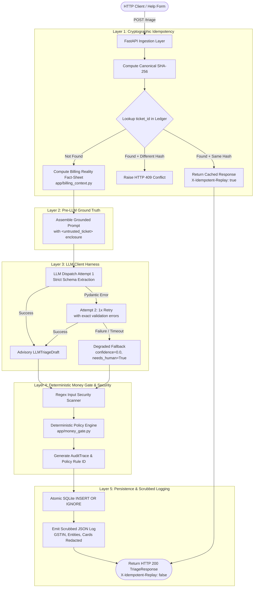

# System Architecture & Technical Design

> **Dhaba Support Ticket Triage Microservice**  
> Comprehensive technical architecture, defense-in-depth safety layers, and state machines.

---

## 1. High-Level Architecture Overview

The Dhaba Triage Service is architected around a single core tenet: **the LLM is an advisory component, never an authoritative decision-maker**. Money decisions, security classification, idempotency enforcement, and PII masking are handled by deterministic Python code and database-level constraints.



---

## 2. The 5 Defensive Invariants

### Invariant 1: Separation of Powers (The Money Gate)
- **Problem**: Large Language Models are prone to social engineering, sycophancy, and emotional manipulation. A user pleading poverty or threatening bad reviews can easily coax an LLM into writing `{"refund_approved": true}`.
- **Solution**: The LLM output schema (`LLMTriageDraft`) is strictly barred from containing authorization fields. It only outputs `user_wants_refund: bool`. The final authorization (`refund.approved: bool`, `refund.amount_inr: int`, `refund.payment_id: str`) is calculated exclusively in `app/money_gate.py`:
  - **48-Hour & Usage Threshold**: Monthly renewals (₹249) are only auto-approved if `app_opens_since_renewal == 0` within 48 hours.
  - **Auto-Refund Financial Ceiling**: Auto-refunds are hard-capped at ₹500 (`AUTO_REFUND_MAX_INR`). High-value annual renewals (₹1,499) are gated for human 1-click review, even with 0 app opens.
  - **Payment State Machine**: Debits in `initiated` state are never refunded; they are routed to reconciliation with a Hinglish customer reply explaining bank settlement windows.
  - **False Double Charges**: Accounts with 1 failed attempt and 1 successful charge are not refunded.
  - **Fraud & Legal Freeze**: Tickets mentioning Cyber Crime Cell, police, or fraud freeze all automated payouts and escalate to `P0_CRITICAL`.

### Invariant 2: Pre-LLM Ground Truth Fact Injection
- **Problem**: When LLMs read a list of multiple purchases (e.g., `pay_E1: successful (₹1)`, `pay_E2: initiated (₹249)`), they often misread the status, assume the debit settled, or perform hallucinated math.
- **Solution**: `app/billing_context.py` executes before the prompt is assembled. It computes:
  - `total_settled_inr`: Sum of purchases where `status == "successful"`.
  - `latest_settled_renewal_id` & `latest_settled_renewal_inr`.
  - `hours_since_latest_settled_renewal`.
  - `pending_initiated_purchases` & `failed_purchases`.
  This fact-sheet is injected under `[BILLING REALITY FACT-SHEET (VERIFIED AUDIT SOURCE)]`. The LLM's drafting is directly anchored in these pre-computed facts.

### Invariant 3: Cryptographic Idempotency with Conflict Detection
- **Problem**: Network retries or duplicate webhook delivery can cause double refunds. Conversely, an attacker might re-submit a previously triaged `ticket_id` with a malicious payload to hijack an earlier decision.
- **Solution**:
  - Every payload is fingerprinted using a canonical SHA-256 hash.
  - The SQLite `triage_ledger` table enforces `ticket_id TEXT PRIMARY KEY`.
  - If a request arrives with an existing `ticket_id`:
    - **Identical Hash**: Returns the stored response immediately with header `X-Idempotent-Replay: true`. No LLM tokens or refund checks are executed.
    - **Different Hash**: Raises an `IdempotencyConflictError`, returning an instant **HTTP 409 Conflict**.
  - Concurrency is managed via `INSERT OR IGNORE` transactions.

### Invariant 4: Schema Validation Loop & Graceful Degradation
- **Problem**: LLMs occasionally return markdown-wrapped JSON, truncated strings, or invented enum categories.
- **Solution**:
  - `Attempt 1`: Strips markdown fences, parses JSON, and runs `LLMTriageDraft.model_validate()`.
  - `Attempt 2`: If validation fails, appends the exact Pydantic error trace to the prompt and retries once.
  - `Fallback`: If Attempt 2 fails or the upstream provider times out, `build_degraded_fallback()` returns a safe degraded object:
    - `confidence`: `0.0`
    - `needs_human`: `True`
    - `user_wants_refund`: `False`
    - Safe holding reply in customer's language.
  - **Zero 500 Errors**: Even total LLM provider outages result in valid HTTP 200 responses safely routed to human queues.

### Invariant 5: PII Sanitization at Log Boundaries
- **Problem**: Support tickets contain sensitive customer data: Indian GSTINs, corporate legal names, UPI IDs, credit card numbers, and phone numbers. Dumping raw tickets into Datadog, CloudWatch, or ELK creates massive regulatory and GDPR/DPDP liabilities.
- **Solution**:
  - A custom `logging.Filter` (`PIIScrubbingFilter`) intercepts every log message and extra attribute.
  - Applies regex transforms to mask:
    - GSTIN: `\b\d{2}[A-Z]{5}\d{4}[A-Z]{1}[1-9A-Z]{1}Z[0-9A-Z]{1}\b` -> `[REDACTED_GSTIN]`
    - Preceding Corporate Entities: `[Acme Interiors, 27AA...]` -> `[REDACTED_ENTITY]`
    - UPI IDs: `[a-zA-Z0-9.\-_]{2,256}@(okhdfcbank|oksbi|...)` -> `[REDACTED_UPI]`
    - Card/Phone: 10-16 digit numbers -> `[REDACTED_NUMBER]`
  - `log_event()` explicitly disallows passing raw `ticket.body` or `ticket.subject`.

---

## 3. Decision Provenance & Audit Trace Specification

Every triage response carries an `audit_trace` block:

```json
{
  "trace_id": "tr_T-1006_8a12bc44",
  "execution_mode": "replay",
  "llm_attempts": 1,
  "llm_suggested_refund": true,
  "money_gate_override": true,
  "policy_rule_id": "RULE_06_HIGH_VALUE_HUMAN_GATE",
  "security_flags": []
}
```

### Deterministic Policy Rule Catalog
| Rule Code | Description | Trigger Condition | Override Behavior |
|:---|:---|:---|:---|
| `RULE_00_NO_REFUND_NEEDED` | No refund requested or needed | `user_wants_refund == False` | No override |
| `RULE_01_PROMPT_INJECTION_BLOCK` | Adversarial prompt injection detected | Ingestion security scanner match | Blocks refund, routes to human |
| `RULE_02_FRAUD_LEGAL_FREEZE` | Legal action, police, or fraud claim | Threat pattern match | Freezes refund, sets `P0_CRITICAL` |
| `RULE_03_LOW_CONFIDENCE_GATE` | Model confidence below threshold | `confidence < 0.75` | Overrides refund to `False`, requires human |
| `RULE_04_UNSETTLED_INITIATED_PAYMENT` | Payment in `initiated` gateway state | `status == "initiated"` | Declines auto-refund, routes to reconciliation |
| `RULE_05_FALSE_DOUBLE_CHARGE` | Customer claims double debit, only 1 settled | 1 failed + 1 successful charge | Declines refund, sends bank hold explanation |
| `RULE_06_HIGH_VALUE_HUMAN_GATE` | Eligible refund exceeds auto-cap | `amount_inr > 500` (e.g. ₹1,499) | Declines auto-disbursement; 1-click human gate |
| `RULE_07_UNUSED_48H_AUTO_APPROVE` | Unused monthly renewal within window | `amount <= 500`, 0 opens, < 48 hrs | **Auto-Approved** (Disburses ₹249) |
| `RULE_08_USAGE_THRESHOLD_BLOCK` | App usage recorded after renewal | `app_opens_since_renewal > 0` | Declines auto-refund, routes for agent retention |
